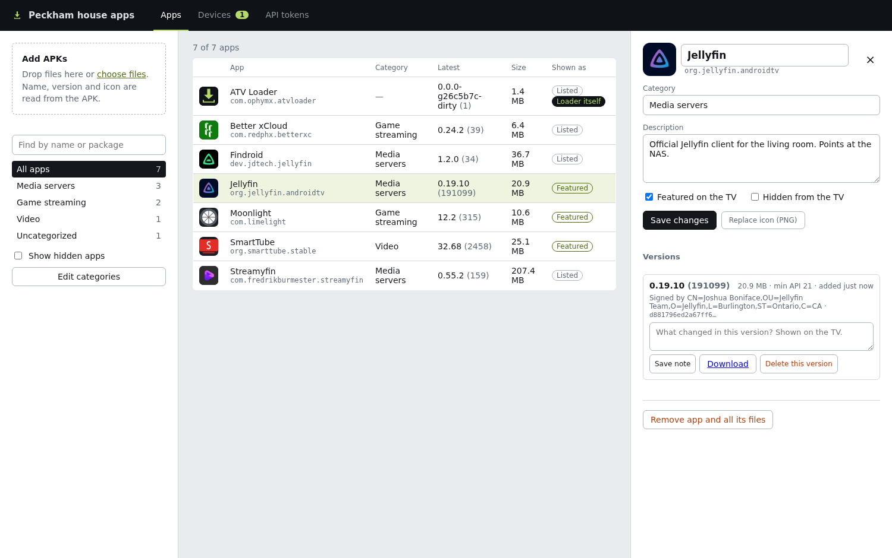
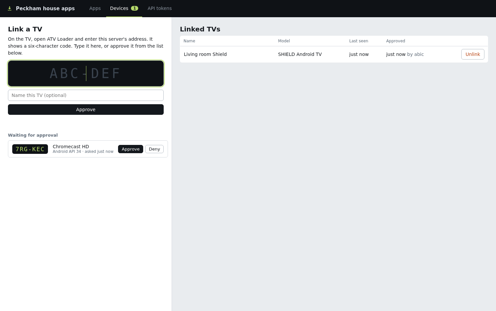
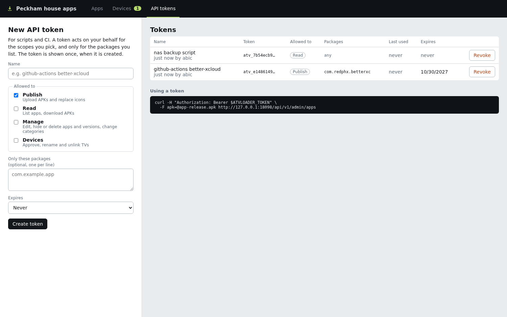

# atvloader

A private app store for Android TV, for a homelab. Upload APKs in a browser, browse and install them on the couch with the remote. No file manager, no Downloader app, no typing URLs on the TV.

Three parts, one repo:

- **An Android TV app** (`tv/`, Kotlin + Compose for TV). Pairs with your server with a six-character code, shows the catalog as rows of apps, installs, updates and uninstalls them through the system package installer, and updates itself from the store.
- **A server** (`server/`, one Go binary). Stores the APKs, reads name, version and icon out of each one, and serves a REST API to the TV app. Ships as a `.deb`, a tarball or a Docker image.
- **A web admin UI** (embedded in the server). Drag-and-drop uploads, categories, descriptions, TV approval and API tokens for CI. Sits behind your existing reverse-proxy login.

Also here: `deploy/` (example nginx config for oauth2-proxy), `packaging/` (systemd unit and Debian scripts), `tools/` (version script and asset generator).



<p>


</p>

<!-- TODO before v0.1.0: TV screenshots (shelf, app page, pairing code) go here; see docs/screenshots/README.md -->

**Why not F-Droid?** An F-Droid repo is a signed static index and needs a separate client that was not built for a remote; adding an app means running `fdroid update` and copying files around. atvloader is a single server with an upload button and a TV-first client, and it is the only thing you need to install on the TV. It does not implement the F-Droid index format.

## How it fits together

```
 TV app  ──bearer token──▶  /api/v1/apps, /download, /icon   ┐
 TV app  ──no auth──────▶  /api/v1/info, /api/v1/device/*    ├─ atvloader-server ─ ./data
 Browser ─oauth2-proxy──▶  /admin/, /api/v1/admin/*          ┘
```

The admin side has **no login of its own**: a browser session is whoever the identity header from nginx + oauth2-proxy says it is (`X-Forwarded-User` by default), and scripts use [API tokens](#api-tokens-for-automation) minted on the admin page. TVs authenticate with a bearer token they get through an activation-code flow:

1. The TV asks the server for a code and shows it (`ABC-DEF`).
2. You open the admin page → Devices, see the code in the waiting list (or type it), and approve it.
3. The TV, which has been polling, receives its token and loads the store.

Unlinking a TV from the Devices page invalidates its token; the TV drops back to the pairing screen.

### The loader updates itself from the store

The server carries the ATV Loader APK it was built with (`server/self/atvloader.apk`, embedded into the binary; `make apk` stages it, or point `-self-apk` / `ATVLOADER_SELF_APK` at a file). At startup it is imported into the catalog as a *protected* app: always listed, cannot be hidden or removed. When a TV sees a newer version of itself in the catalog it shows an "update now" banner above the shelves, and installs it through the normal package installer; the app restarts on the new build.

To ship a new TV build: tag a release (`git tag v0.2.0 && git push origin v0.2.0`). The tag sets the APK's version (see [Build the TV app](#build-the-tv-app)), CI builds and signs it, and the server in that release embeds it. Install the new server and every linked TV offers the update on its next refresh. Locally, `make apk && make run` does the same with a snapshot version.

## Build and run

```sh
make apk        # TV app → server/self/atvloader.apk (needs the Android SDK, see below)
make server     # → dist/atvloader-server with the APK embedded
make run        # serve ./data on :8080
make test       # server and TV app unit tests
```

Or skip the toolchains and run the published image, which has the matching TV app built in:

```sh
docker compose up -d        # ghcr.io/ophymx/atvloader:latest, data in ./data
# or build it yourself: make apk && docker compose up -d --build
```

### Debian package

[GoReleaser](https://goreleaser.com) (`.goreleaser.yaml`) builds the server for amd64 and arm64 and packages it as a `.deb` with a systemd unit, an `atvloader` system user and `/etc/atvloader/env` (loopback listen, `/var/lib/atvloader` data dir, identity header required). Stage the APK first; the build refuses to run without it.

```sh
make apk
make snapshot   # untagged: dist/atvloader_<ver>_{amd64,arm64}.deb + tarballs
make release    # on a v* tag: same, published as a GitHub release (needs GITHUB_TOKEN)
```

Install with `dpkg -i`, then `systemctl start atvloader` and put nginx + oauth2-proxy in front (`/usr/share/doc/atvloader/nginx.conf.example`).

| Setting | Env var | Default |
| --- | --- | --- |
| Listen address | `ATVLOADER_ADDR` | `:8080` |
| Data directory (APKs, icons, `store.json`) | `ATVLOADER_DATA` | `./data` |
| Store name shown on the TV | `ATVLOADER_NAME` | `Homelab apps` |
| Header carrying the admin identity | `ATVLOADER_TRUSTED_HEADER` | `X-Forwarded-User` |
| Reject admin requests without that header | `ATVLOADER_REQUIRE_TRUSTED_HEADER` | `false` |
| Max upload size | `ATVLOADER_MAX_UPLOAD_MB` | `2048` |
| Loader APK to publish instead of the embedded one | `ATVLOADER_SELF_APK` | |

Admin UI: `http://host:8080/admin/`. Until nginx is in front, anyone who can reach the port can administer the store, so set `ATVLOADER_REQUIRE_TRUSTED_HEADER=true` once the proxy is wired up (see `deploy/nginx.conf`; the proxy must strip `X-Forwarded-User` on the non-admin routes, as the example does).

## REST API

Unauthenticated:

| | |
| --- | --- |
| `GET /` | public front page with the loader download, for TV browsers |
| `GET /atvloader.apk` | newest bundled ATV Loader APK |
| `GET /healthz` | `{status:"ok", version}`; for Docker, systemd and proxy health checks |
| `GET /api/v1/info` | `{service:"atvloader", name, version, apps, auth:"device", loader:{package, versionCode, versionName}}` |
| `POST /api/v1/device/code` `{model, product, sdk}` | `{deviceCode, userCode, expiresIn, interval}` |
| `POST /api/v1/device/token` `{deviceCode}` | `{status:"pending"}` / `{status:"approved", token, deviceName}` / `{status:"denied"|"expired"}` |

With `Authorization: Bearer <token>`:

| | |
| --- | --- |
| `GET /api/v1/apps` | `{apps:[…], categories:[…]}` (visible apps, latest version each) |
| `GET /api/v1/apps/{pkg}` | full app with every version |
| `GET /api/v1/apps/{pkg}/icon` | PNG |
| `GET /api/v1/apps/{pkg}/versions/{versionCode}/download` | the APK (supports ranges, `X-SHA256` header) |

Every version carries its `sha256`. The TV app hashes each download and refuses to hand a file to the installer when the hash or the length does not match, so a truncated or tampered download fails with a clear message instead of an installer error. Android then verifies the APK's own signature and, for updates, that it matches the installed app's signer.

Every version also records its `signer` (the signing certificate's subject and SHA-256 fingerprint, read from the v3/v2 signing block or the v1 signature). An upload signed with a different key than the versions already stored is refused with `409 {"code":"signer_mismatch"}`, because TVs with the old version installed could not update to it; the admin UI asks before adding it anyway, and scripts pass `allowSignerChange=1` (query string or form field before the file) to accept it.

Admin (behind the proxy):

| | |
| --- | --- |
| `GET /api/v1/admin/me` | who the proxy says you are |
| `GET /api/v1/admin/apps` | every app including hidden ones |
| `POST /api/v1/admin/apps` multipart `apk=@file` | import; package, version, label, icon and signer are read from the APK; `409 signer_mismatch` unless `allowSignerChange=1` |
| `GET /api/v1/admin/apps/{pkg}` | one app with all versions |
| `GET /api/v1/admin/tokens`, `POST /api/v1/admin/tokens`, `DELETE /api/v1/admin/tokens/{id}` | API tokens (signed-in admins only); `POST` takes `{name, scopes[], packages[], expiresDays}` and returns the secret once |
| `PATCH /api/v1/admin/apps/{pkg}` `{name, description, category, featured, hidden}` | edit |
| `DELETE /api/v1/admin/apps/{pkg}` | remove app and files |
| `POST /api/v1/admin/apps/{pkg}/icon` multipart `icon=@png` | replace icon |
| `PATCH /api/v1/admin/apps/{pkg}/versions/{code}` `{changelog}` | per-version note |
| `DELETE /api/v1/admin/apps/{pkg}/versions/{code}` | remove one APK |
| `GET/PUT /api/v1/admin/categories` `{categories:[…]}` | row order on the TV |
| `GET /api/v1/admin/devices` | linked TVs and codes waiting for approval |
| `POST /api/v1/admin/devices/approve` `{userCode, name}` | link a TV |
| `POST /api/v1/admin/devices/deny` `{userCode}` | |
| `PATCH /api/v1/admin/devices/{id}` `{name}` / `DELETE` | rename / unlink |

Data on disk is plain: `data/store.json`, `data/apks/<pkg>-<versionCode>.apk`, `data/icons/<pkg>.png`. Back up the directory and you have everything.

## Build the TV app

Needs JDK 17+ and the Android SDK (`tv/local.properties` → `sdk.dir`).

```sh
make apk
# → tv/app/build/outputs/apk/release/app-release.apk, copied to server/self/atvloader.apk
```

`make apk` derives the version from git (`tools/version.sh`): `versionName` is `git describe` without the `v`, `versionCode` is `major*1000000 + minor*1000 + patch` of the nearest `v*` tag. Android only installs updates with a higher `versionCode`, so new TV builds mean a new tag. Running `./gradlew assembleRelease` directly produces `0.0.0-dev` / code 1.

Release signing reads `tv/keystore.properties` (`storeFile`, `storePassword`, `keyAlias`, `keyPassword`); without it the APK is signed with the debug key. **Keep the same key forever**: Android refuses to update an app signed with a different key, so losing the keystore means uninstalling ATV Loader from every TV. Create one with:

```sh
keytool -genkeypair -v -keystore tv/keystore/release.jks -alias atvloader \
  -keyalg RSA -keysize 2048 -validity 10000
```

## API tokens for automation

Signed-in admins can mint API tokens on the admin page (API tokens tab) for scripts and CI. A token is a bearer credential for the admin API with a fixed set of scopes and, optionally, a package allow-list. Tokens are shown once at creation, stored hashed, can expire, and can be revoked at any time. Tokens can never create or list tokens.

| Scope | Allows |
| --- | --- |
| `publish` | `POST /api/v1/admin/apps` (upload APKs), `POST .../apps/{pkg}/icon` |
| `read` | `GET /api/v1/admin/apps[/{pkg}]`, icon and APK downloads, categories |
| `manage` | `PATCH`/`DELETE` apps and versions, `PUT` categories |
| `devices` | everything under `/api/v1/admin/devices` |

With a package list, `publish`, `read` and `manage` only work for those packages; an upload of any other APK is refused with 403 and nothing is stored. Listing apps returns only the allowed packages.

```sh
curl -H "Authorization: Bearer $ATVLOADER_TOKEN" -F apk=@app-release.apk https://apps.example.com/api/v1/admin/apps
```

Because tokens authenticate on their own, the reverse proxy must let requests with an `Authorization: Bearer atv_…` header through to `/api/v1/admin/` without the login redirect. With oauth2-proxy, see the `_token` location in `deploy/nginx.conf` for the nginx pattern.

A GitHub Actions step that publishes a release build:

```yaml
- name: Publish to the TV store
  env:
    ATVLOADER_TOKEN: ${{ secrets.ATVLOADER_TOKEN }}
  run: |
    curl --fail-with-body -H "Authorization: Bearer $ATVLOADER_TOKEN" \
      -F apk=@app/build/outputs/apk/release/app-release.apk \
      https://apps.example.com/api/v1/admin/apps
```

## Releases

Pushing a `v*` tag runs `.github/workflows/release.yml`: it builds the signed APK, embeds it in the server, publishes a GitHub release with `atvloader_<ver>_{amd64,arm64}.deb`, the tarballs, `atvloader_<ver>.apk` and `checksums.txt`, and pushes `ghcr.io/ophymx/atvloader:<ver>` (plus `:vX.Y` and `:latest` for stable versions). Every push to `main` and every PR runs `ci.yml`, which runs the tests and does the same build as a snapshot (debug-signed APK when the secrets are absent, images not pushed) and keeps the output as a workflow artifact for a week. Actions are pinned to commit SHAs; Dependabot moves them.

The release job runs in the GitHub Environment `release`, which only `v*` tags may deploy to, and refuses to run without the signing key. Create the environment with a tag rule for `v*` (Settings → Environments; optionally add yourself as a required reviewer so a tag push waits for a click), then add these environment secrets once:

| Secret | Value |
| --- | --- |
| `ANDROID_KEYSTORE_B64` | `base64 -w0 tv/keystore/release.jks` |
| `ANDROID_KEYSTORE_PASSWORD` | `storePassword` from `tv/keystore.properties` |
| `ANDROID_KEY_ALIAS` | `keyAlias` (`atvloader`) |
| `ANDROID_KEY_PASSWORD` | `keyPassword` |

```sh
gh secret set --env release ANDROID_KEYSTORE_B64      --body "$(base64 -w0 tv/keystore/release.jks)"
gh secret set --env release ANDROID_KEYSTORE_PASSWORD --body "$(sed -n 's/^storePassword=//p' tv/keystore.properties)"
gh secret set --env release ANDROID_KEY_ALIAS         --body "$(sed -n 's/^keyAlias=//p' tv/keystore.properties)"
gh secret set --env release ANDROID_KEY_PASSWORD      --body "$(sed -n 's/^keyPassword=//p' tv/keystore.properties)"
git tag v0.1.0 && git push origin v0.1.0
```

## Install it on a TV

The server's front page (`http://host:8080/`) is public and has one big download button, so you can bootstrap from any TV browser: open the page, download, open the APK from the browser's downloads (allow the browser to install unknown apps when asked). The APK is also at the stable URL `/atvloader.apk`. `adb install` works too. On first launch:

1. Enter the server address, e.g. `http://192.168.1.10:8080` (plain HTTP is fine on the LAN; cleartext is enabled).
2. Approve the code on the admin page → Devices.
3. The first install prompts for "Install unknown apps"; the app sends you to the right settings page.

Once ATV Loader is itself uploaded to the store it can update itself from there like any other app.

## Layout of the TV screen

Rows, in order: *Updates available*, *Featured*, each category in the order set under "Edit categories", uncategorized apps, then *Installed*. An app's page shows the description, install/update/open/uninstall, and every uploaded version so an older one can be installed if a new build misbehaves.
